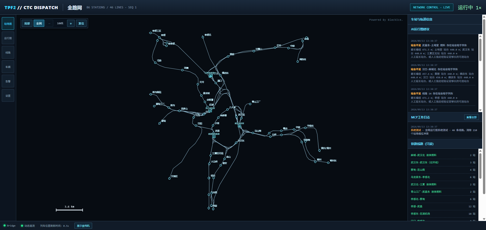
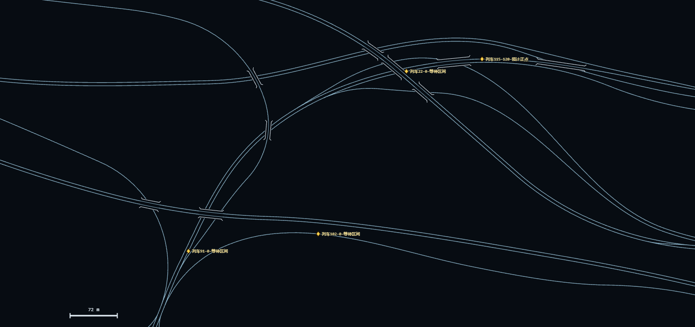
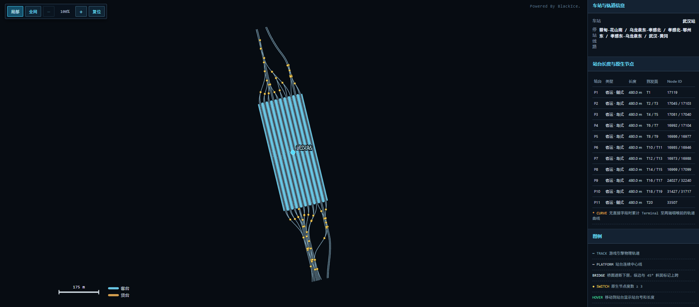
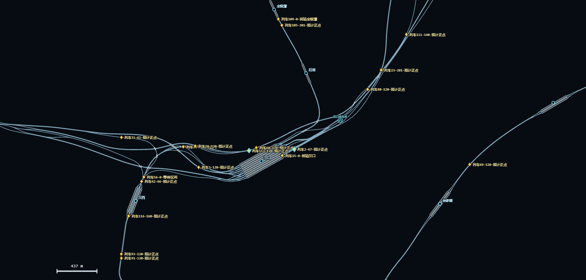
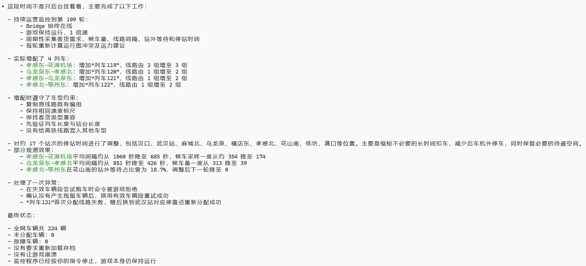

# TPF2 MCP

让 AI / MCP 客户端能够观察、理解并在受控条件下辅助运营
[Transport Fever 2](https://www.transportfever2.com/) 的本地 Mod 项目。

当前主线通过游戏内 Lua Mod、原生 Loader/Controller DLL 和 Python MCP Server，
向 AI 提供世界目录、完整铁路网、列车遥测以及临时限速/停车控制。
HTTP MCP 采用 Streamable HTTP，可供多个本机客户端连接同一个服务。

## 功能展示

### 全网调度总览

<p align="center">
  
</p>

从一个页面查看全网铁路拓扑、车站、线路、AI 运行图建议、MCP 工作日志和 Bridge
实时状态。地图以游戏引擎原始轨道坐标绘制，并按缩放层级呈现全网与局部站场信息。

### 路网、站场与实时运行

<p align="center">
  
</p>

多层线路跨越：系统依据轨道三维数据识别上下跨关系，并在俯视图中保留桥梁结构。

<p align="center">
  
</p>

武汉站局部站场图：可查看站台、咽喉、道岔、站台长度和原生节点信息。

<p align="center">
  
</p>

运行中列车在物理轨道上的实时位置、速度与状态。

<p align="center">
  
</p>

一次连续九小时的 MCP 运营过程：需求监控、编组约束校验、加车、停站时间调整和异常恢复。

## 能做什么

当前生产 MCP 暴露 **15 个工具**，数据读取走 Loader 共享内存，控制走 Controller V2 命令通道。
上方图片保留项目已有功能与历史实验展示，不代表其中每项能力均已迁入当前 MCP。

| 工具 | 已实现功能 |
| --- | --- |
| `get_bridge_status` | 检查 Loader、Controller 命令通道和世界目录状态 |
| `get_train_control_snapshot` | 全部列车或指定 `display_name` 的运行数据，可选单节车辆数据 |
| `set_train_speed_limit` | 对列车前方路径窗口设置临时限速；速度为 0 时请求停车 |
| `cancel_train_speed_limit` | 根据 `command_id` 撤销本 MCP 进程创建的规则 |
| `get_active_train_controls` | 查询当前进程记录的未过期控制 |
| `get_world_catalog_status` | 世界快照时间、采集器状态及实体/路网数量 |
| `get_towns` / `get_town` | 城市列表与单个城市 |
| `get_industries` / `get_industry` | 产业列表与单个产业 |
| `get_stations` / `get_station` | 站组列表与单个站组 |
| `get_lines` / `get_line` | 线路列表与单条线路 |
| `get_rail_network` | 完整铁路网摘要和分区分页数据 |

实体列表支持 `offset`、`limit`、`name_contains`，单个实体使用 `entity_id`。
铁路网通过 `section` 选择 `summary`、`nodes`、`edges`、`stations`、`lines`、`depots`，
按返回的 `next_offset` 读取后续页。完整路网在这里指铁路网，不包含完整道路网络。

列车遥测包括显示名称、所属线路、长度、当前速度、技术最高速度、轨道/命令限速、
加速度、载客与货量、轨道边位置及前方路径摘要。采样目标为 5 Hz，实际频率取决于游戏更新回调。
未验证的数值返回 `null`，部分产业类型等字段仍可能为 `UNKNOWN`；世界目录是低频快照，读取时应结合时间和采集状态。

旧文件 Bridge 的候车人数、线路需求、排图、网络分析、模拟、购买车辆与 Task/Operation
流程尚未完成迁移，已从生产 MCP 隔离。当前也不暴露旧 `tpf2://` resources。

## 原生通信与控制

Lua 在游戏内加载 `tpf2_loader.dll`，将采集结果交给 Loader 的双缓冲共享内存。
Loader 通过 `LoadLibrary` 加载 Controller，并监听热重载事件。
Python 使用 `ControllerCommandClient`，通过共享内存命令队列与内核事件下发控制。
源码工程名为 `tpf2_controller`，当前 Mod 包中的 DLL 名为 `tpf2_control.dll`。

`set_train_speed_limit` 参数示例：

```json
{
  "command_id": "dispatch-001",
  "display_name": "列车3",
  "speed_kmh": 30,
  "lookahead_edges": 24,
  "expires_in_seconds": 20,
  "confirmation": "APPLY_SPEED_LIMIT:dispatch-001",
  "reason": {
    "kind": "FRONT_TRAIN_TOO_CLOSE",
    "distance_threshold_m": 500
  }
}
```

速度允许 0–500 km/h，且不得超过列车技术最高速度；0 会发送停车 `hold`。
作用范围为前方 1–192 条路径边（默认 24），有效期 5–120 秒（默认 20）。
服务端检查路径窗口新鲜度和路径索引；同名列车会被拒绝。同一进程内重复的 `command_id` 会去重。

`reason` 必填，支持两类原因：

- `FRONT_TRAIN_TOO_CLOSE` + `distance_threshold_m`：记录“与前车距离过近，小于xx米，减速/停车”。
- `WAIT_ENTRY_SIGNAL` + `waiting_for_train`（列车显示名称）：记录“等待进站信号机开放，减速/停车待避列车x”。

速度为 0 时记录“停车”，大于 0 时记录“减速”。原因由调用方提供，不代表服务端已自动核实车距或信号状态。
撤销使用 `cancel_train_speed_limit`，传入 `command_id` 和 `confirmation: "CANCEL_SPEED_LIMIT:<command_id>"`，
日志原因固定为“取消限速命令”。

控制记录保存在 MCP 进程内存中，重启后不恢复；活跃控制查询不是 Controller 的全量规则查询。
Controller 到期后不再应用该规则，列车驶出指定路径范围也不再受该规则限制。

## 调用日志

每次 MCP 启动创建一个按启动时间命名的 UTF-8 JSONL 文件：

```text
logs/mcp/YYYY-MM-DD_HH-MM-SS_微秒.jsonl
```

日志位于服务所属仓库或 Mod 根目录，记录启动信息、每次工具调用的开始、参数、完成状态、
错误、耗时及控制回执。确认串和常见凭据字段会脱敏，完整遥测结果不会整份写入日志。
HTTP 基础访问日志另外由 Uvicorn 输出；运行日志不纳入 Git。

## 项目组成

- `tpf2_mod/`：Transport Fever 2 Lua Mod 源码。
- `mcp_server/`：Python HTTP/stdio MCP Server、共享内存解析与控制发送器；保留待迁移的旧模块。
- `native/tpf2_native/`：Visual Studio 解决方案及 `tpf2_loader`、`tpf2_controller` 两个 C++ 工程源码。
- `ui/rail-map/`：独立 Vite 铁路调度图前端。
- `tools/`：安装、测试、导出、打包和验收工具。

## 快速体验

1. 在 Windows x64 游戏中启用含 Loader/Controller DLL 的 `tpf2mcp` Mod，并进入存档。
   原生 DLL 必须与当前游戏版本匹配。
2. 当前新版 Python MCP 从源码仓库独立运行，使用 Python 3.11+。
   从仓库根目录创建虚拟环境、安装依赖并启动：

   ```powershell
   python -m venv .venv
   .\.venv\Scripts\python.exe -m pip install -r .\mcp_server\requirements.txt
   .\.venv\Scripts\python.exe .\mcp_server\start_http_server.py
   ```

   如果使用 Conda 创建的 `.venv`，Python 通常位于 `.\.venv\python.exe`，按实际环境路径执行。
   客户端选择 **Streamable HTTP**，填写 `http://127.0.0.1:8766/mcp`。
   健康检查为 `http://127.0.0.1:8766/health`；游戏连接状态使用 `get_bridge_status` 核验。
   可用 `--port` 或 `TPF2_MCP_HTTP_PORT` 修改端口。接口变更后客户端应重新连接刷新工具定义。
   可选设置 `TPF2_MCP_HTTP_TOKEN`，客户端携带 `Authorization: Bearer <token>`。
   默认仅监听本机；云端客户端无法直接访问本机 `127.0.0.1`。

   stdio 入口 `mcp_server/start_server.py` 仍保留，由客户端作为子进程启动。
   多客户端共享控制状态使用同一个 HTTP 服务。

3. 铁路图属于独立开发组件，部分数据访问仍待迁移到新链路。
   需要启动 Web API 时进入 `mcp_server/` 执行：

   ```powershell
   python start_api.py
   ```

4. 另开终端启动前端：

   ```powershell
   cd ..\ui\rail-map
   npm install
   npm run dev
   ```

5. 浏览器打开 `http://127.0.0.1:5173/?view=network`。

Mod 不会自动启动外部进程；MCP Server、FastAPI API 和前端需要单独启动。
当前 MCP 限速使用命令编号、原因与显式确认串，不走隔离中的旧 Task 审批流程。

## 原生构建与打包状态

使用 Visual Studio C++ 工具链构建 `native/tpf2_native/tpf2_native.slnx`。
原生 Mod 打包入口为：

```powershell
powershell -ExecutionPolicy Bypass -File .\tools\build-native-mod.ps1 -NativeRoot .\native\tpf2_native
```

脚本生成以 `_数字` 结尾的 Mod 目录与原生包，默认目录名为 `tpf2_mcp_1`，不包含 Python/UI。
当前新版 Python 服务尚未随本轮改动重新组装进 Mod。旧 `build-workshop-package.ps1`
还保留旧原生构建引用，完整新版发布流程待整理。


## 当前状态

当前共享内存世界目录、铁路网、列车遥测和原生限速已在真实存档中验证。
上方文档目录中仍包含旧文件 Bridge、历史运营实验与尚未迁移的设计，当前生产能力以本文工具清单为准。
源码、测试及两个 C++ 工程纳入 Git；DLL、构建产物和运行数据暂不纳入。

本项目暂时处于未完工状态。
