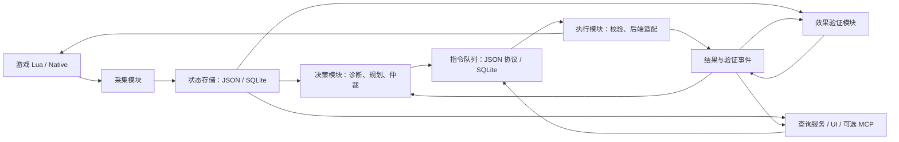

# 本地模块化调度系统设计

状态：架构目标草案，2026-09-19；2026-09-25 校订。区域采集、JSON/SQLite 和影子协调已部分落地，通用游戏执行适配器、具体动作接口与统一验证仍待完成。本文的 SET_SPEED_LIMIT/ASSIGN_PLATFORM/REASSIGN_OD 等目标示例不能视为现有公共 API 契约；当前代码行为见 [当前能力](CURRENT_CAPABILITIES.md)。迁移待办见 `agents/ENGINEERED_CONTROL_SYSTEM_TODO.md` 第 9 节。

## 1. 目标与现状

持续采集游戏状态，持久发布数据；业务模块按协议读取数据并计算决策；决策以 JSON 指令交给执行模块；执行模块反馈接收、下发和实际效果。整个循环在本机运行，不需要大模型或 MCP 在线。

当前可复用：Lua Bridge、原生 Hook、遥测归一化、运行图规划器、拥堵建议器、操作后验检查、租约机制。当前需要拆分：`tools/serve-rail-map.py` 同时管理采集、规划和执行；`control_system.py` 同时做决策、发布租约和验证；`dispatch_platform.py` 部分策略命令仅修改功能开关，不能视为目标策略已执行。

## 2. 模块边界



| 模块 | 负责 | 边界 |
|---|---|---|
| collector | 读取 Lua 遥测和原生状态，标注来源、采样时间、缺失字段，归一化列车/线路/占用 | 不做调度决策，不发布游戏写命令 |
| storage | 发布完整快照、保存历史、提供版本化只读查询 | 不推导业务策略；JSON 为实时快照权威源，SQLite 为历史和指令权威源 |
| decision | 拥堵识别、站台/进路联合规划、发车间隔、上游流量、客货分流和运力方案 | 只读快照及结果，输出建议和候选指令，不调用 Bridge 或写 native INI |
| arbiter（decision 内） | 合并候选指令、管理资源预约、处理冲突和优先级 | 一个决策周期只发布一个确定的计划版本，避免多个策略抢同一列车 |
| command store | 持久接收 JSON 指令、幂等去重、执行认领、结果事件 | 不执行指令；通过事务保证计划与待执行命令一起提交 |
| executor | 再校验当前状态、选择后端、发布/撤销有界控制、返回回执 | 不运行拥堵优化算法，不因收到命令自动开启写权限 |
| verifier | 用后续采样和相关后端回执检查效果，输出证据和失败原因 | 不以“文件写入成功”或全局 Hook 计数上涨判定单条业务成功 |
| query service | UI/MCP 查询、配置和指令提交入口 | HTTP 读取不触发采集、排图或游戏写入；MCP 不直接访问 Bridge 文件 |
| supervisor | 进程生命周期、模式、心跳、实例锁、日志和恢复 | 同一游戏会话只允许一个执行者；能力状态区分已支持、未验证、不可用 |

建议源码位于 `mcp_server/src/tpf2_mcp/dispatch_runtime/`，按 `collector/`、`storage/`、`decision/`、`executor/`、`verification/`、`contracts/` 分包，保留现有算法逐项迁移。

部署采用一个调度启动器管理采集、决策、执行三个独立 worker；验证先放在执行 worker 内，查询/UI 是独立服务。模块用持久协议交换信息，不共享可变 Python 对象。无需 Kafka、Redis 等外部服务。先允许这些 worker 在测试中单独运行，UI 关闭或重启不影响调度。

## 3. 数据存储和采集

发布运行数据全部位于实际 `<active_mod_root>/bridge/dispatch/`；开发回放数据放项目 `diagnostics/dispatch/`。路径由安装位置解析，不包含固定账号或盘符。

```text
bridge/dispatch/
  current.json                         # 当前存档、会话和完整帧指针
  sessions/<session_id>/
    topology/<version>.json             # 静态路网、站台、信号，变更后新版本
    frames/<sequence>.json              # 近期不可变实时帧
    operations/<version>.json           # 较低频的编组、载荷、运营详情
    dispatch.sqlite                    # 历史、计划、指令、事件、资源预约
    logs/*.jsonl                       # 供人阅读的轮转诊断日志
```

- 快照携带 `schema_version / save_id / session_id / sequence / topology_version / sampled_at / game_time_ms / simulation_speed / source / quality`。同一存档重载也产生新会话，防止旧命令误作用于复用 ID。
- 位置目标采样周期 0.2 秒，UI 目标刷新 0.25 秒；新帧驱动快速决策，初始最多每秒两次；排图等重计算低频或事件触发。实际频率必须测量，不能用定时器配置冒充达标。
- 位置帧不包含整套路网和长历史。不同来源保留各自采样时间，不把旧载荷/站台状态伪装为本帧最新数据。
- 先原子写完整帧，再原子替换 `current.json`。读者固定一个版本，不能读取到一半更新的数据；读取失败保留上一完整帧并标记过期。
- 为近期快照设置保留窗口，读者遇到版本被清理可重读最新指针；重计算/回放任务显式固定需要的输入。全量拓扑仅在变化时生成。
- SQLite 使用 WAL、短事务、连接独立及有界忙重试。运行库至少包含 `telemetry_samples`、`congestion_events`、`plans`、`commands`、`command_events`、`reservations`；索引以会话、对象、时间和指令状态为主。
- 高频帧仅短期保留，SQLite 降采样保存长期趋势；指令与结果不降采样。日志按大小/时间轮转，保留参数可配置，禁止无限积累。
- 决策通过只读 `SnapshotReader` / `HistoryReader` 获取协议数据；替换存储实现不改变算法。JSONL 只用于诊断或导出，不作为并发指令队列。

## 4. 指令协议 v1

在 `protocol/dispatch/` 新增观测、指令、结果 JSON Schema，独立于现有 Bridge 请求协议。公共调度语义转换为已有 Bridge/Lua/原生协议只发生在执行适配器内。

示例（ID、时间和区段均为虚构）：

```json
{
  "schema_version": 1,
  "command_id": "cmd-example-001",
  "idempotency_key": "plan-42:train-123:approach-limit",
  "plan_id": "plan-42",
  "source": "decision.congestion",
  "save_id": "save-example",
  "session_id": "session-example",
  "based_on": {"sequence": 8102, "topology_version": "topology-7"},
  "type": "SET_SPEED_LIMIT",
  "target": {"vehicle_id": 123, "line_id": 45},
  "parameters": {"edge_ids": [101, 102], "speed_kmh": 60},
  "preconditions": {"expected_line_id": 45, "max_state_age_ms": 2000},
  "priority": 50,
  "issued_at": "2026-09-19T08:00:00Z",
  "expires_at": "2026-09-19T08:00:10Z",
  "lease_ms": 5000,
  "reason": {"code": "APPROACH_METERING", "evidence_ids": ["congestion-17"]}
}
```

约定：UTC 用于展示、审计和接收期限；执行过程计时使用单调时钟，游戏时刻用于运行图与倍速换算。跨进程不比较不同进程的单调时钟原点；暂停不允许旧指令在恢复后无条件补发。

`expires_at` 是最后允许下发时间；`lease_ms` 是下发后的控制时长。续租是有新 ID/版本、指向原租约的显式命令，不通过重复提交延长租约。`based_on.sequence` 是决策依据，执行时允许更新帧，但必须重新检查时效、对象身份、线路、路网版本及命令特有前置条件。

首批指令：`SET_SPEED_LIMIT`、`HOLD_TRAIN`、`RELEASE_HOLD`、`ASSIGN_PLATFORM`、`SET_PATH_COST`、`APPLY_TIMETABLE`、`REASSIGN_OD`、`CANCEL_COMMAND`。购售车、编组和线路操作通过后续 `FLEET_TASK` 包装既有任务流程。

每种类型具有独立参数校验和能力声明。`ASSIGN_PLATFORM` 指明具体目标站台，`SET_PATH_COST` 指明边及代价；不能把“开启 station/path 功能”当成执行了指定目标。旧策略开关保留为配置接口。

执行结果示例：

```json
{
  "schema_version": 1,
  "event_id": "evt-example-003",
  "command_id": "cmd-example-001",
  "session_id": "session-example",
  "status": "VERIFIED",
  "at": "2026-09-19T08:00:04Z",
  "backend": "native.speed",
  "backend_receipt_id": "lease-generation-55:cmd-example-001",
  "observed": {"sequence": 8122, "vehicle_id": 123, "edge_id": 101, "speed_kmh": 58.7},
  "verification": {"predicate": "ZONE_SPEED_LIMIT", "matched_samples": 3},
  "error": null
}
```

结果状态：`QUEUED → ACCEPTED → DISPATCHED → VERIFIED`；另有 `REJECTED / FAILED / EXPIRED / CANCELLED / UNKNOWN`。生命周期以事件追加，并维护当前投影；限速一次验证通过后，仍监测租约直到结束。接口返回 `202 + command_id` 仅代表入队。

验证要求按指令区分：限速需对象进入目标区段、后端规则确实匹配、考虑制动过渡后连续速度达标；站台需匹配目标及锁定状态；路径需比较实际路径，惩罚命中只是中间证据；OD 需相关对象/数量的回执，候车总量变化只作辅助。无法关联到命令的原生计数须标记能力限制，不能报 `VERIFIED`。

## 5. 可靠投递和统一执行

- command store 是队列权威源：决策通过 `CommandPublisher` 事务写入，执行者通过 `claim` 事务认领，结果通过 `ResultWriter` 返回。各模块只写自己的记录，UI/MCP 经服务接口提交。
- 交付按至少一次设计；`session_id + idempotency_key` 唯一，相同键不同内容拒绝。持久保存后端请求 ID，不能宣称游戏副作用严格 exactly-once。
- 崩溃发生在下发后、记回执前时，恢复为 `UNKNOWN`，先核对后端和实测状态。购车/售车等不可盲目重发；不支持可靠核对时停止该任务并报告。
- 同列车同类互斥命令串行。独立速度约束取最小值；释放只撤销指定所有者的租约，不清除其他来源的限制。对同一资源的人工覆盖采用显式优先级及有效期，不能绕开基础设施和游戏合法性校验。
- 站台、进路、发车应形成带依赖的计划：先预约资源，再下发；前置失败则取消尚未执行步骤并重算。游戏动作不是数据库原子事务，已执行步骤分别记录与补偿，不能声称整组回滚。
- 官方 API 优先，只有能力表明确支持且验证状态满足要求时使用原生适配器。Native INI 由一个聚合发布者写入完整租约代次，避免旧工具/控制循环相互覆盖。
- 保留 `DISABLED / SHADOW / ARMED` 和降级、熔断状态。SHADOW 结果独立标记为模拟；超时、切档、数据过期停止新动作，撤销本系统租约并按后端能力解除本系统扣停。
- Python 退出后，原生与 Lua 侧须各自有看门狗和租约到期处理；不依赖已退出的执行进程清理。紧急停用意为解除本系统控制，不是将所有列车紧急刹停。

## 6. 拥堵业务闭环

以“汉口站某进站方向持续排队”为示例，不假定当前地图正发生该事件。

1. 采集列车、站台、进路占用与到发状态，诊断器识别持续排队，区分短时红灯、站台占满、咽喉冲突及下游堵塞。
2. 规划器生成等待、换站台、换进路、上游站内暂缓发车、提前限速等候选方案。资源按站台、冲突进路和下游容纳空间建模，不能只数站台有几辆车。
3. 用未来滚动时间窗比较总等待、后续队列、吞吐、优先级与最大等待时间；动态成本替代固定 300 秒作为后续目标。预测不确定性过大时缩小干预范围，给出原因。
4. 联合选择站台和进路，避免空闲站台的到达路径反而阻塞更重要的出站车。只允许游戏可达、方向正确、长度匹配且未锁定的选择；不构造未经游戏验证的路径。
5. 上游流量控制优先站内待避；提前减速需足够制动距离并避开道岔冲突区。普通扣停必须保证所选位置可容纳整列车；零速保护能力尚未最终验收的后端不能启用自动业务。
6. 仲裁器预约资源并发布 JSON 命令；执行器重新检查当前状态，执行后返回结果；验证器读新帧确认，失败或环境变化则重新规划。
7. 判断效果看区间通过量、平均/高分位总延误、最大等待、队列长度和溢出，不能仅以机外停车减少证明成功；把队列移到上游也必须计入延误。
8. 能力持续不足时发布模板建议，区分扩站台、改咽喉、增加通过线和调整发车密度。客货分流不自动等于轨道车流减少，必须与班次/编组方案联动验证；堵塞时不盲目加车。

## 7. 迁移与验收

先定义协议和回放样本，再抽离采集/存储，再拆纯决策和执行适配器，最后加入拥堵联合优化。新执行者接管时关闭旧发布路径，禁止双写 native 配置或双发 Lua 命令。

验收按“协议测试、离线回放、影子运行、限定范围实机、长期指标”递进。必须覆盖重复投递、下发中崩溃、旧会话、拓扑变化、遥测过期、暂停/倍速、冲突命令、租约失效、资源释放，以及 UI 退出后采集/调度仍运行。

拥堵算法使用相同快照和策略版本进行确定性回放；实机效果采用可比运行条件和足够观察窗口，不用 Hook 命中次数替代吞吐和延误。现有实机证据继续保留；新架构、新零速控制和新增算法分别验收，不继承旧 TODO 的完成状态。
